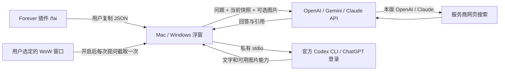

# 设计与核实依据

研究日期：2026-10-12。支持目标是暴雪官方 WoW: Forever；不复用 Classic Era 的玩法数据。
本项目是独立实现，没有复制以下参考项目的源代码。

## 插件与传输

`C_QuestLog` 提供任务条目、目标和完成状态，`C_Map` 提供允许读取的位置。
代码使用 `pcall` 和 secret-value 检查，任何不可读字段都不得通过字符串转换等方式绕过。
`INSPECT_READY` 只缓存用户正常观察目标后的已公开装备；目标变化就清空缓存。
每个快照携带实际客户端 build 和采集时间，不读取战斗血量、伤害或技能循环。
JSON 编码由固定程序实现，不解析或执行外部 Lua、宏或模型输出。

addon 0.3.0 新增 `Snapshot.lua`，以显式字段名单采集 27 类资料。独立类别分别隔离 API 失败，
输出 `coverage`、范围、时间和未知原因；`completeGameState` 始终为 false。
银行和 NPC 资料仅在对应窗口打开时读取，专业配方还检查当前配方所属角色；不能确认归属时
不把 learned 字段解释成当前角色的学习历史。不展开标题、改变筛选、选择任务或发起服务端刷新。
不缓存关闭窗口前的银行或专业数据。详见 [快照数据契约](snapshot.md)。

继续使用 `schemaVersion: 1`，旧的角色／任务／装备字段不变，现有 Mac / Windows 0.4.2 助手
保留并发送新增字段，无需重装桌面应用。总量预留到 180 KB 以下，包含 Python 重序列化的
分隔空格余量；长列表按类别和总量削减并记录限制，字符串截断不拆开 UTF-8 字符。
这不是完整数据库导出，不通过任意全局表扫描、受限值转字符串或执行 SavedVariables 补齐资料。

addon 0.3.0 沿用 0.2.0 的 `/fai` 复制流程，只弹出 320×148 面板，普通 EditBox 保持可聚焦、内容全选，
用 alpha=0 隐藏 JSON；“准备复制”按钮恢复完整选区。由用户亲自按 Command+C / Ctrl+C，
使用客户端 EditBox 的原生复制行为。没有模拟按键、自动剪贴板调用或系统侧游戏控制。
检测复制快捷键后的提示只是让用户到助手粘贴，不宣称已读取或确认操作系统剪贴板。
关闭、Esc、回车或进入战斗时立即清除焦点及临时导出文本。快捷键在真实客户端仍需验证。

依据是 Forever 客户端的生成声明
[`OsDocumentation.lua`](https://github.com/Gethe/wow-ui-source/blob/943764493e6b16d63ded3ab304150d1f05e58b57/Interface/AddOns/Blizzard_APIDocumentationGenerated/OsDocumentation.lua)：
`CopyToClipboard` 标记为 `HasRestrictions`；不能因为暴雪自有 UI 使用它就推定普通 addon 获得同样权限。
公开的 EditBox 声明提供 `SetFocus` 和 `HighlightText`，本插件仅用这些方法准备用户手动复制。

纯插件没有通用 HTTP/IPC 能力。SavedVariables 通常在登出或 reload 时写盘，不能作为
低延迟双向消息接口。现有社区项目 [wow-ai](https://github.com/chelinho139/wow-ai) 声明通过
像素输出和按需加载插件文件回传数据；这证明存在技术尝试，不证明获得暴雪允许。
其 [架构文档](https://github.com/chelinho139/wow-ai/blob/main/docs/ARCHITECTURE.md)
是桥接限制的参考。本项目采用用户选定的桌面浮窗，不实现这种桥接。

本项目不运行 MCP 服务或客户端；外部检索由 OpenAI / Claude 内置 web search 或 Codex 官方搜索完成。以后若增加
MCP，应限于明确配置的只读查询工具，不给模型 shell、游戏输入或任意文件权限。

## 截图与隐私

窗口枚举只读取操作系统窗口标题、PID 和可执行文件名，`OpenProcess` 仅请求
`PROCESS_QUERY_LIMITED_INFORMATION`。它不读取进程内存，也不注入游戏。
用户选择窗口后，每次截图前重新核对 HWND/PID/可执行文件。只有已识别的 WoW 可执行文件
进入选择列表。选定窗口失效即停止，不回退到全桌面。

Mac 由一个打包在应用内的固定 Swift 组件读取窗口元数据，严格按本机 WoW 可执行文件名筛选，
不以窗口标题授予捕获资格。截图前再次核对窗口 ID、PID 与可执行文件名，再使用
`SCContentFilter(desktopIndependentWindow:)` 和 `SCScreenshotManager.captureImage` 截取单窗口。
不创建显示器捕获、持续视频流、音频流或整屏回退。PNG 经进程管道交给 Python，普通 API 路径只在内存；Codex CLI 的临时文件例外见下文。
应用启动不枚举窗口；用户点击刷新时只枚举元数据；仅用户点击「授予截图权限」才调用系统权限申请，其他捕获路径只检查已有权限。
当前实现要求 macOS 14+，编译成功和模拟测试不代表真实游戏帧已验证。

Windows 使用独立 C# 组件调用 Windows Graphics Capture 的 `CreateForWindow`，每次只绑定所选
HWND，使用自由线程帧池获取一帧后释放。组件前后校验 HWND、PID 与游戏可执行文件，
拒绝最小化、窗口重用、内容尺寸变化与超时；没有显示器捕获、窗口标题匹配或 GDI 回退。
捕获过程保留系统提示边框，不获取鼠标指针，不要求隐藏边框权限。
像素以有长度上限的 BGRA 协议经 stdout 返回，Python 校验尺寸与字节数并将透明区域置黑。
图片不落盘；8 秒进程超时会终止本次组件。失败仍允许用户选择游戏截图文件。
这是 SDR 路径；HDR 色彩、独占全屏、游戏自身绘制的覆盖层及真实游戏的遮挡表现需单独验证。
黑图检测仅能拒绝明显无效帧，不能单凭编译和模拟测试宣称真实游戏截图已通过。

截图在内存中重编码去除元数据，最长边缩至 2048 像素；每次发送至多一张。
Codex CLI 的 `--image` 要求文件路径，因此此路径短暂写入每请求独立的私有目录，
POSIX 文件权限为 0600，正常结束、异常和超时均清理。强制结束整个应用可能残留临时文件。
图片选择时间与实际原始截图时间区分标注。密钥只在内存，不保存到插件、浏览器或磁盘。
模型仅允许官方固定 HTTPS 端点；HTTP 重定向被拒绝，错误响应原文不显示以避免回显密钥。

## 模型选择与 Gemini

提供商和模型是联动下拉框；模型可直接编辑。预设目录在 `companion/providers.py`，核对日期
2026-10-11，不把预设当成用户账号授权或实时可用性保证。切换提供商会重置密钥、模型和后续
请求历史，同一提供商内可更换模型而不丢弃 key。搜索偏好在进程内按提供商保留。

Gemini 使用官方 `v1beta/models/{model}:generateContent`，key 只放 `x-goog-api-key` 请求头，
不放 URL。模型路径只接受单个字母数字 ID 组件，不允许斜线、查询参数、百分号编码或片段。
历史的 assistant 角色映射为 model；当前截图以内联 PNG 发送。响应只显示普通文本，不显示
thought 分段。输入被阻止、空回答、输出截断会给出明确提示；不自动重试。

Google Search grounding 要求随回答完整显示关联 Search Suggestions。本版 Tk 界面没有 HTML
搜索展示组件，因此 Gemini 的搜索开关禁用，构造器拒绝显式搜索请求；不会悄悄忽略开关或
将模型链接和训练数据 citationMetadata 伪装成网页搜索证据。Gemini 可分析用户提供的任务和图片。

## 小窗与本机 Codex 连接

主窗口 320 × 380，最小 280 × 260；可收起为窄栏。设置用独立的可滚动 Toplevel，
不会一直遮挡聊天。主输入框识别完整 `/fai` JSON，先校验再作为上下文保存，不把 JSON
当命令执行或作为普通长聊天误发。模型请求仅保留最近四轮文字，聊天视图也限制文本与图片数量。
0.4.2 在聊天区显示每次快照导入的成功/失败结果，成功附任务数并聚焦提问框；失败保留旧快照
和草稿。不回显剪贴板原文、不发送模型请求、不持续监听剪贴板；仅用户粘贴时读取。

`local_codex.py` 通过官方 CLI 的 `exec --json` 读取 JSONL，先检查受支持的选项和登录状态。
不读取认证文件、不提取 token、不启动 HTTP listener、不把 shell 命令拼成字符串。
问题走 stdin，附图仅走私有临时路径；剔除继承的 API key、端点覆盖与其他 agent 线程变量。
使用空临时工作目录、忽略用户配置、ephemeral、read-only、never approval、禁用 MCP/插件/
shell/电脑操作/技能发现等选项，网页搜索按用户开关。模型输出永远不执行。
CLI 自身仍负责登录、网络请求、账号额度、内部连接重试及服务端数据处理。
CLI 的网页工具可能依赖 `code_mode_host` 运行组件；桥接显式启用此组件，同时保持 shell、
电脑操作、插件与用户 MCP 禁用。不能只用开关配置证明联网成功。
这就是官方 Codex harness 的非交互运行方式，并非将模型 API 改名为 Codex。
目前未采用持久 app-server 会话，也未接入专门的魔兽官方资料 API/MCP；网页搜索不需要
游戏控制权限。未来资料工具应按游戏版本、参数和认证单独接入，不能声称目前已经具备。

Codex 默认使用 CLI 自选模型，不复用桌面内部模型名称或 API 预设。用户可手动输入
CLI 接受的 ID。连接仍需兼容版本的官方 CLI 和相应登录；仅安装桌面应用不保证可用。

Claude 官方凭据规则不允许第三方应用转接 Free/Pro/Max OAuth，故不实现 Claude Code
订阅代理。独立 Sign in with ChatGPT 流程有官方支持，但需另做注册/授权集成，本版未实现。

## 回复图片

`ReplyImage` 区分远端攻略图片和生成图片；UI 嵌入缩略图、点击放大、显示来源或 AI 示意图标签。
模型提供的 Markdown 图片 URL 不是结构化搜索引用，仍需核对版本和来源。
每个回答最多三张配图，最多保留十二张可放大的聊天缩略图。

`reply_images.py` 对下载地址要求公开 HTTPS、标准端口、无凭据，无控制字符；校验全部 DNS
结果，使用校验过的数值 IP 建立 TLS 连接并验证主机名，阻止 DNS rebinding。重定向逐跳
重新校验，不读环境 HTTP proxy，不传 cookie/API key。限制 8 MB、2000 万输入像素，
只解码 PNG/JPEG/WebP/GIF 首帧，重编码去元数据；不执行 HTML/SVG 或下载模型指定的本地文件。
失败保留回答和链接，不自动转生成图。下载是有限时长的后台工作。

0.4.1 取消模式下拉菜单，普通回复始终解析文字、Markdown 来源图片及支持的原生图片块。
API 聊天通过 `image_tools.py` 按三家标准 function calling 契约提供 `generate_illustration`，
由模型根据用户的自然语言要求决定是否使用。未配置图片连接/key 或附有截图时不提供此工具，
并将能力限制告知模型。工具只能指定长度受限的图片描述，不能指定服务商、端点、key 或命令。
只接受已完成响应中的单个有效调用；重复、未知、截断或无效调用不会触发生图。

图片结果作为本轮终点直接返回 UI，没有额外模型续写，单轮最多一次聊天请求和一次生图请求。
使用已配置的 OpenAI Images `/v1/images/generations` 或 Gemini `/v1beta/interactions`
（`store:false`）；失败保留文字、不重试也不自动换服务商。Gemini 只显示 model_output，
不显示 thought 内容。密钥不进入工具定义或模型参数，切换图片连接会清空其独立 key。
API 生图仅接受文字和快照，附截图时正常问答但不提供生成工具。

Codex 启用原生 image_generation 能力，由 agent 决定是否调用；不强制每条问题生成图片，
也不因生图而关闭已启用的网页搜索。解析完整 JSONL 中的图片结果；实际能力由所使用的
CLI 与账号决定。能力失败须如实说明，没有自动转 API。

当前官方 `exec` 的 JSONL 事件类型不包含生图结果，图片扩展却会将输出保存到
`CODEX_HOME/generated_images/<thread-id>`。0.4.1 因此读取该调用 `thread.started` 事件
提供的 UUID 对应的专属目录，只接受请求开始后生成的 PNG、最多三张、每张 8 MB，拒绝
目录符号链接、文件链接和硬链接，不扫描其他线程、不读取认证或历史文件。CLI 自己管理的
原图保留，助手只把校验后的副本放进内存。模型无法指定这个读取目录。
同时兼容未来 JSONL 图片块和本请求临时目录内的 Markdown 图片；不接受任意外部本地路径。
这些兼容契约随 CLI 版本变化需要重新验证。
必须收到并校验实际图片，不能把 CLI 的文字“已生成”当作图片交接成功。

## 回答的可信度

采用版本、ID、来源优先的提示词；装备掉落与配方来源不能由物品属性推出。
任务建议不能仅按直线距离排序：应考虑前置任务、目标进度、等级、组队需求和已知交通。
这些是模型建议，不是已验证路线求解器。来源缺失、搜索失败、输出截断都显示核对提示。
引用来自服务商结构化 annotations/citations，UI 仅允许点击 HTTP(S) 地址。
引用存在本身不证明回答正确；Beta 内容变化和社区数据缺失仍需核查。

## 规则边界

遵守公开 API 和避免自动操作是实现边界，不能直接推出“合规认证”。当前未取得暴雪对
外部 AI 截屏建议程序的明确认可。尤其不能用 OCR/截图绕过受保护战斗信息限制。
插件若分发必须考虑免费、源码可见、不得破坏游戏体验等要求；用户自付第三方 API 费用
与插件相关收费政策的具体适用也未得到官方裁定。

## 查阅的主要来源

- [暴雪 WoW: Forever 官方页面](https://worldofwarcraft.blizzard.com/en-us/forever/)
- [暴雪 UI Add-On Development Policy](https://us.forums.blizzard.com/en/wow/t/ui-add-on-development-policy/24534)
- [暴雪关于 Midnight 插件与受保护战斗数据的说明](https://worldofwarcraft.blizzard.com/en-us/news/24246290/combat-philosophy-and-addon-disarmament-in-midnight)
- [Forever 客户端生成的任务 API 文档镜像](https://github.com/Gethe/wow-ui-source/blob/forever/Interface/AddOns/Blizzard_APIDocumentationGenerated/QuestLogDocumentation.lua)
- [Forever 地图 API 文档镜像](https://github.com/Gethe/wow-ui-source/blob/forever/Interface/AddOns/Blizzard_APIDocumentationGenerated/MapDocumentation.lua)
- [Forever 物品 API 文档镜像](https://github.com/Gethe/wow-ui-source/blob/forever/Interface/AddOns/Blizzard_APIDocumentationGenerated/ItemDocumentation.lua)
- [Codex 非交互调用](https://developers.openai.com/codex/noninteractive)
- [Codex harness 集成方式](https://developers.openai.com/blog/codex-as-a-platform)
- [Codex exec 的 JSONL 事件类型](https://github.com/openai/codex/blob/main/codex-rs/exec/src/exec_events.rs)
- [官方生图产物路径](https://github.com/openai/codex/blob/main/codex-rs/ext/image-generation/src/artifact.rs)
- [官方图片保存根目录](https://github.com/openai/codex/blob/main/codex-rs/app-server/src/extensions.rs)
- [OpenAI function calling](https://developers.openai.com/api/docs/guides/function-calling)
- [Gemini GenerateContent 工具契约](https://ai.google.dev/api/generate-content)
- [Claude 工具定义](https://platform.claude.com/docs/en/agents-and-tools/tool-use/define-tools)
- [Sign in with ChatGPT](https://developers.openai.com/siwc/quickstart)
- [Claude 凭据规则](https://code.claude.com/docs/en/legal-and-compliance#authentication-and-credential-use)
- [OpenAI 图片生成](https://developers.openai.com/api/docs/guides/image-generation)
- [Gemini 图片生成](https://ai.google.dev/gemini-api/docs/image-generation)
- [Gemini Interactions](https://ai.google.dev/gemini-api/docs/interactions-overview)
- [OpenAI 图像输入](https://developers.openai.com/api/docs/guides/images-vision)
- [OpenAI API 认证](https://developers.openai.com/api/reference/overview)
- [OpenAI web search](https://developers.openai.com/api/docs/guides/tools-web-search)
- [OpenAI 模型目录](https://developers.openai.com/api/docs/models)
- [Gemini 模型目录](https://ai.google.dev/gemini-api/docs/models)
- [Gemini GenerateContent](https://ai.google.dev/api/generate-content?hl=en)
- [Gemini Google Search 展示要求](https://ai.google.dev/gemini-api/docs/generate-content/google-search)
- [Gemini Grounding 条款](https://ai.google.dev/gemini-api/terms)
- [Claude Messages](https://platform.claude.com/docs/en/api/messages/create)
- [Claude 模型目录](https://platform.claude.com/docs/en/models/overview)
- [Claude web search](https://platform.claude.com/docs/en/agents-and-tools/tool-use/web-search-tool)
- [Pillow 单窗口截图接口](https://pillow.readthedocs.io/en/stable/reference/ImageGrab.html)
- [Pillow 12.3.0 原生 GDI 路径](https://github.com/python-pillow/Pillow/blob/12.3.0/src/display.c)
- [Microsoft Windows Graphics Capture 按 HWND 创建目标](https://learn.microsoft.com/en-us/windows/win32/api/windows.graphics.capture.interop/nf-windows-graphics-capture-interop-igraphicscaptureiteminterop-createforwindow)
- [Apple ScreenCaptureKit 截图接口](https://developer.apple.com/documentation/screencapturekit/scscreenshotmanager)
- [Apple 单窗口捕获过滤器](https://developer.apple.com/documentation/screencapturekit/sccontentfilter/init(desktopindependentwindow:))
- [PyInstaller macOS 应用构建](https://pyinstaller.org/en/stable/usage.html)

这些来源确认接口或作者的观察，不等同于本原型的真机测试或暴雪批准。
